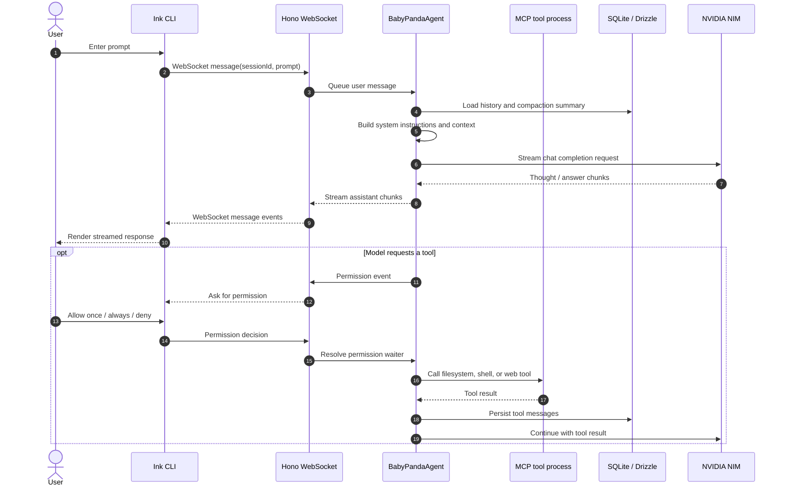
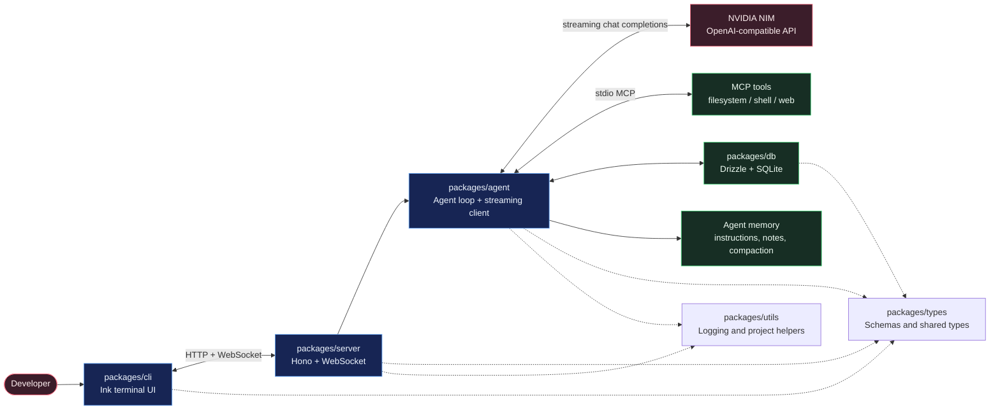
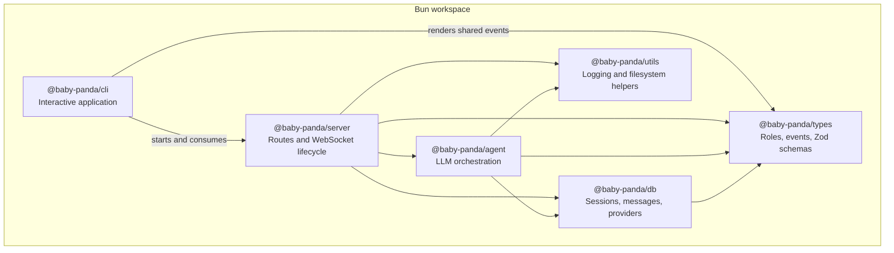
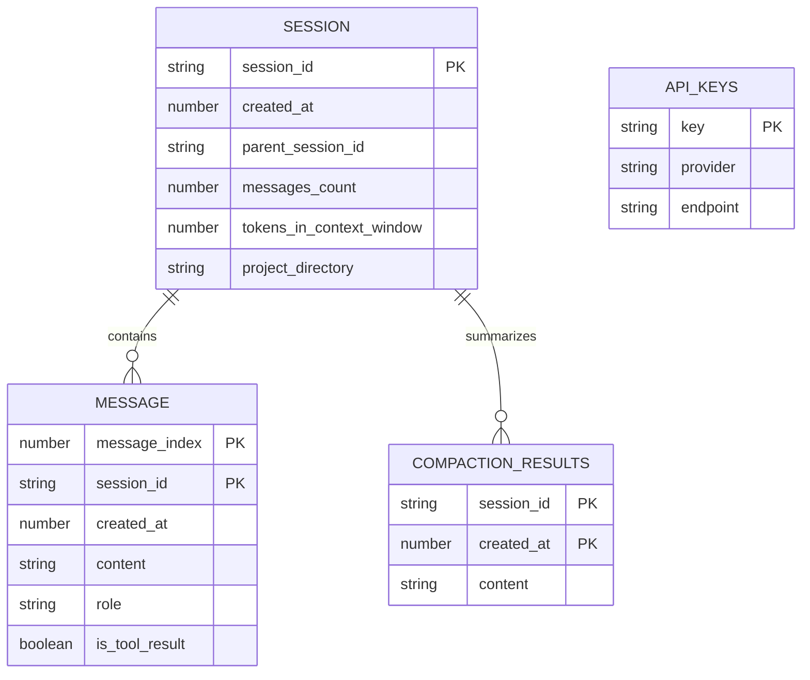

# BabyPanda

> **Project status: under construction and highly unstable.**
>
> BabyPanda is an experimental terminal AI coding assistant. APIs, database
> migrations, configuration, and user experience may change without notice.
> **Only the NVIDIA NIM provider is currently supported.** Other providers are
> not ready for use, even though provider data is stored in the database.

BabyPanda combines a terminal UI, a WebSocket server, a streaming LLM agent,
MCP tools, persistent conversation history, and lightweight long-term memory.
It is organized as a Bun workspace monorepo written in TypeScript.

## Contents

- [BabyPanda](#babypanda)
  - [Contents](#contents)
  - [Requirements](#requirements)
  - [Quick start](#quick-start)
  - [Environment variables](#environment-variables)
  - [Running the project](#running-the-project)
    - [Terminal application (recommended)](#terminal-application-recommended)
    - [Server only](#server-only)
  - [How a request flows](#how-a-request-flows)
  - [Architecture](#architecture)
    - [System overview](#system-overview)
    - [Internal package relationships](#internal-package-relationships)
    - [Persistent data](#persistent-data)
  - [Workspace packages](#workspace-packages)
  - [HTTP and WebSocket endpoints](#http-and-websocket-endpoints)
  - [Database and migrations](#database-and-migrations)
  - [Development commands](#development-commands)
  - [Known limitations](#known-limitations)

## Requirements

- [Bun](https://bun.sh/) with workspace support
- A valid [NVIDIA API key](https://build.nvidia.com/)
- A terminal that supports the interactive Ink UI
- Linux or macOS is recommended for development; Windows support has not been
  verified

Check the Bun installation with:

```bash
bun --version
```

## Quick start

From the repository root:

```bash
# 1. Install all workspace dependencies
bun install

# 2. Create the local environment file
cp .env.example .env

# 3. Edit .env and replace the placeholder with your NVIDIA key
$EDITOR .env

# 4. Apply the local SQLite migrations
bun run --filter @baby-panda/db migrate-production

# 5. Start the terminal application
bun run --filter @baby-panda/cli dev
```

The CLI starts the local Hono server and opens the BabyPanda terminal
interface. The server listens on `http://localhost:3000`. To continue an
existing session, pass its session ID as the first CLI argument:

```bash
bun run --filter @baby-panda/cli dev -- SESSION_ID
```

Do not commit `.env` or paste your NVIDIA key into source code, logs, issues,
or pull requests.

## Environment variables

Copy `.env.example` to `.env` before running the application:

| Variable          | Required | Default   | Description                                                                                                              |
| ----------------- | -------- | --------- | ------------------------------------------------------------------------------------------------------------------------ |
| `NVIDIA_API_KEY`  | Yes      | —         | Bearer token used for NVIDIA NIM chat completions.                                                                       |
| `IN_DEV_MODE`     | No       | `false`   | When `true`, uses `~/.babypanda/db/db.test.db`; otherwise uses `~/.babypanda/db/db.db`.                                  |
| `BABY_PANDA_PORT` | No       | Automatic | Optional fixed local HTTP and WebSocket port. Without it, BabyPanda selects the first available port from `3500` upward. |

The current server always targets the NVIDIA NIM endpoint:

```text
https://integrate.api.nvidia.com/v1/chat/completions
```

The environment file does not currently configure provider selection, model
selection, or database path.

## Running the project

### Terminal application (recommended)

The CLI is the primary end-user entry point. It starts the server in-process,
creates a session when one is not supplied, and renders the interactive
terminal UI:

```bash
bun run --filter @baby-panda/cli dev
```

To run multiple instances, start the same command in each terminal. BabyPanda
automatically selects ports starting at `3500` and moves to the next available
port:

```bash
# Terminal 1
bun run --filter @baby-panda/cli dev

# Terminal 2
bun run --filter @baby-panda/cli dev
```

The selected port is used by both the in-process HTTP server and the CLI
WebSocket client. Set `BABY_PANDA_PORT` only when a specific fixed port is
required.

### Server only

For server-side development, run the Hono server directly:

```bash
bun run --filter @baby-panda/server dev
```

The standalone server exposes the HTTP and WebSocket interfaces, but the CLI
is still required for the intended interactive experience.

## How a request flows

The following sequence shows the normal path from a user prompt to a streamed
response. Permission prompts are sent back to the CLI before a tool is
allowed to run.



## Architecture

### System overview



### Internal package relationships



### Persistent data



By default, the database is created at
`~/.babypanda/db/db.db`. Development mode uses the separate
`~/.babypanda/db/db.test.db` file to reduce the chance of contaminating local
development data.

## Workspace packages

| Package                                | Responsibility                                                                                                   |
| -------------------------------------- | ---------------------------------------------------------------------------------------------------------------- |
| [`packages/cli`](./packages/cli)       | Ink/React terminal interface, session startup, WebSocket client, permissions, and streamed message rendering.    |
| [`packages/server`](./packages/server) | Hono HTTP routes, WebSocket upgrade handling, agent lifecycle, and event forwarding.                             |
| [`packages/agent`](./packages/agent)   | NVIDIA chat client, agent loop, context construction, MCP integration, memory, compaction, and tool permissions. |
| [`packages/db`](./packages/db)         | Drizzle schema, SQLite connection, migrations, and persistence methods.                                          |
| [`packages/types`](./packages/types)   | Shared TypeScript types, enums, and Zod validation schemas.                                                      |
| [`packages/utils`](./packages/utils)   | Cross-package helpers such as project naming and log writing.                                                    |

## HTTP and WebSocket endpoints

The local server currently provides:

| Method | Path                | Purpose                                                                                                                  |
| ------ | ------------------- | ------------------------------------------------------------------------------------------------------------------------ |
| `POST` | `/start-session`    | Create and return a new session ID.                                                                                      |
| `POST` | `/get-session`      | List sessions for the current project directory.                                                                         |
| `POST` | `/get-messages`     | Return cleaned message history; requires a `sessionId` JSON field.                                                       |
| `POST` | `/add-provider`     | Store provider data; requires `key`, `provider`, and `endpoint`. NVIDIA NIM remains the only supported runtime provider. |
| `GET`  | `/ws?sessionId=...` | Upgrade to a WebSocket for streamed messages, tool events, and permission events.                                        |

These endpoints are experimental and do not currently provide authentication
or a production deployment contract.

## Database and migrations

Migration files live in [`packages/db/drizzle`](./packages/db/drizzle).

```bash
# Generate a migration after changing the Drizzle schema
bun run --filter @baby-panda/db generate

# Apply migrations to the normal local database
bun run --filter @baby-panda/db migrate-production

# Apply migrations to the isolated test database
bun run --filter @baby-panda/db migrate-dev
```

## Development commands

Run these from the repository root:

```bash
# Type-check every workspace package
bun run type-check

# Lint the complete repository
bun run lint

# Format supported files
bun run format

# Type-check one package
bun run --filter @baby-panda/agent type-check
bun run --filter @baby-panda/server type-check
bun run --filter @baby-panda/cli type-check
bun run --filter @baby-panda/db type-check
```

## Known limitations

- **NVIDIA NIM only:** the runtime endpoint and API key are hard-coded to the
  NVIDIA integration path; OpenAI, Anthropic, local models, and other
  providers are not currently supported.
- **Experimental persistence:** migrations and schema are still evolving.
- **Local-first operation:** the application assumes a local filesystem,
  local SQLite database, and a local terminal.
- **Limited operational safeguards:** there is no production authentication,
  multi-user isolation, or deployment guide yet.
- **Unstable behavior:** streaming, retries, MCP tools, permissions, and
  compaction are actively being built and may fail or change.

If you report a bug, include the command you ran, operating system, Bun
version, whether `IN_DEV_MODE` was enabled, and a redacted error log. Never
include `NVIDIA_API_KEY`.
